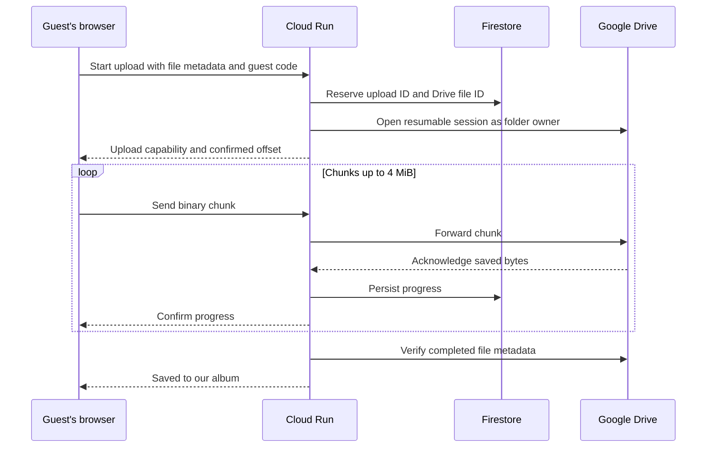

# Google Cloud uploader for Krisha & Joe

This backend replaces the Apps Script upload lock with independent resumable
uploads to the existing Drive folder. The wedding website can stay on GitHub
Pages. Guests continue using its Photos section without Google sign-in.



Each file can be up to **500 MiB** (shown as 500 MB in the interface), with 20
files per selection. Only one file per browser is sent at once to keep mobile
memory use low. Across browsers, uploads run independently. No global upload
lock or whole-file base64 conversion is used.

Cloud Run is configured for **20 simultaneous requests per instance and up to
5 instances**. These settings target the requested 50–100 concurrent guests;
they are not a measured capacity guarantee. Actual performance depends on
Google Drive quotas, file sizes, network conditions and the deployed service.
The per-file Firestore lease coordinates retries across instances. A generated
Drive file ID is persisted before upload so retrying a transfer can only create
that one destination file.

Completion verifies the allocated file ID, byte size, MIME type, upload marker
and non-trashed state. The destination folder is set when creating the upload.
Folder-parent metadata is excluded from upload completion checks and transfer
diagnostic comparisons. Retrying an existing selection can confirm its already committed
file without re-uploading its bytes.

## 1. Create a project and sign in

Create a dedicated [Google Cloud project](https://console.cloud.google.com/projectcreate)
and enable billing. Install the [Google Cloud CLI](https://cloud.google.com/sdk/docs/install)
on your computer and use Node.js 22 or newer. Run the helpers below from this
repository on that computer; the OAuth callback opens on its loopback address.

```bash
gcloud auth login
npm --prefix backend ci
```

The deployment helper enables the required APIs, creates a native Firestore
database if needed, grants runtime/build service accounts their roles, and
deploys the backend. You need project permissions to perform those operations.
The runtime service account accesses Firestore and the five selected secrets;
it does not receive ownership of your Drive folder.

Cloud Run compute, network traffic, builds, Firestore and Secret Manager may
incur charges. This design has no always-on instance and limits configured
scaling, but does not impose a hard spending cap. Set a billing budget alert
and review usage during the live load test.

## 2. Create the owner's OAuth client

In [Google Auth Platform](https://console.cloud.google.com/auth/overview), configure
the application branding and audience for your account, and add the Drive scope
`https://www.googleapis.com/auth/drive` under Data Access. Create a **Web application**
OAuth client with this exact authorized redirect URI:

```text
http://127.0.0.1:8765/oauth2callback
```

Use the Google account that owns or can add files to the destination:

```text
1x_-4yfn1Ar9q1xXvcf0rFoVpGKEzTi_k
```

The full Drive scope is used because the destination is an existing folder;
the narrower `drive.file` scope requires access granted through the app, such
as a folder selected with Google Picker. Only the folder owner authorizes this
OAuth client. Guests never authorize Google scopes. Credentials stay in Secret
Manager and the Cloud Run process, and are never sent to the website.

An external OAuth application left in **Testing** normally receives a Drive
refresh token that expires in **seven days**. Before the final authorization,
use the appropriate production publishing status for your application and
follow Google's verification requirements or documented personal-use exception.
An unverified-app notice may still appear for personal use. A service account
alone cannot own files in a personal My Drive account, which is why this setup
uses owner OAuth rather than sharing the folder with the runtime account.

If authorization shows **“The app is currently being tested” / Error 403:
access_denied**, open **Google Auth Platform → Audience → Test users → Add
users** in the project that owns the OAuth client. Add the exact Google account
you will use to authorize Drive, save it, then rerun `authorize-drive.mjs` and
open its newly generated URL. Being a project owner does not automatically add
the account to the OAuth test-user list. Only the Drive owner needs this test
access; wedding guests do not use Google OAuth. This unblocks testing but does
not remove the seven-day testing token expiry described above.

References: [OAuth token expiration](https://developers.google.com/identity/protocols/oauth2#expiration),
[OAuth verification exceptions](https://developers.google.com/identity/protocols/oauth2/production-readiness/sensitive-scope-verification#exceptions),
[Drive service accounts](https://developers.google.com/workspace/drive/api/guides/about-shareddrives).

## 3. Save credentials and authorize Drive

Replace `YOUR_PROJECT_ID` below with your actual project ID. The first helper
prompts privately for the OAuth client ID, client secret and the existing guest
password. **Use the same guest password as `VITE_SITE_PASSWORD`.** It generates
the separate signing key automatically and preserves that key on later reruns.
Values are passed to Secret Manager through stdin, without writing credential
files or printing tokens.

```bash
node backend/scripts/setup-secrets.mjs --project YOUR_PROJECT_ID
node backend/scripts/authorize-drive.mjs --project YOUR_PROJECT_ID
```

Setup immediately prints the project and numbered steps. The API-enabling step
can take a few minutes on a new project; it prints a waiting message every 15
seconds and stops after 15 minutes if Google has not responded. Other cloud
operations have a two-minute timeout. If a step times out, check the project in
the Google Cloud console before retrying; a remote operation may still finish.
Credential input is deliberately hidden, so press Enter after pasting each
value. If the command shows no output at all, press Ctrl+C and rerun it from
this checkout in a normal interactive terminal. `gcloud --version` should work
first, followed by `gcloud auth login` if you are not signed in.

The second command prints a Google authorization URL. Open it on the same
computer, sign in as the Drive owner, and grant access. It checks the callback
state, uses PKCE, exchanges the code, and stores the refresh token directly in
Secret Manager. Do not paste credentials or tokens into chat or the frontend
environment. If port 8765 is in use, stop the process using it before retrying.

Secrets created:

| Secret | Backend variable |
| --- | --- |
| `wedding-drive-client-id` | `GOOGLE_CLIENT_ID` |
| `wedding-drive-client-secret` | `GOOGLE_CLIENT_SECRET` |
| `wedding-drive-refresh-token` | `GOOGLE_REFRESH_TOKEN` |
| `wedding-upload-code` | `UPLOAD_CODE` |
| `wedding-upload-token-secret` | `UPLOAD_TOKEN_SECRET` |

The guest password is a shared invitation code, visible in the existing static
website bundle. It limits casual public submissions but does not identify
individual guests. Each initiated upload additionally gets its own signed
capability. CORS restricts browser origins, rather than authenticating callers.

## 4. Deploy

Use the exact website **origin**, excluding any path and trailing slash. For
example, a website at `https://example.github.io/wedding-website/` has the origin
`https://example.github.io`. If the site has a custom domain, use that domain.

```bash
node backend/scripts/deploy.mjs --project YOUR_PROJECT_ID --origin https://YOUR_WEBSITE_HOST
```

The default region is `asia-southeast1` (Singapore); the optional `--region`
argument overrides it. The helper uses the wedding folder above unless you
pass `--folder ANOTHER_FOLDER_ID`, useful for a separate test folder. Source
uploads exclude local dependencies, tests and credentials through `.gcloudignore`.

The helper creates `wedding-photo-uploads`, sets the configured concurrency and
instance limits, and prints its HTTPS URL. It pins enabled secret versions for
the deployment. After refreshing credentials or changing the guest password,
rerun the deployment helper to select the new versions. IAM changes may take a
few minutes to propagate; retry if a first build is denied immediately after
granting the builder role.

Firestore documents in `weddingPhotoUploads` expire after 24 hours. The backend
enforces expiration immediately; Firestore TTL removes old session records
asynchronously. Expiration does not remove completed files from Drive. An
unfinished transfer needs a new selection after its session expires. Within
the same page selection, retries retain the upload ID and resume from the
last bytes acknowledged by Drive. Refreshing the page loses its file selection.

## 5. Connect the existing website

Set these values in `.env.local` for local development:

```bash
VITE_PHOTO_UPLOAD_PROVIDER=cloud-run
VITE_PHOTO_UPLOAD_ENDPOINT=https://YOUR_UPLOAD_SERVICE.run.app
```

Keep the existing `VITE_SITE_PASSWORD` value and ensure it matches the backend
upload code. Restart Vite after environment changes. To test localhost, explicitly
add its exact origin (for example `http://localhost:5173`) to the backend's
`ALLOWED_ORIGINS` along with the production origin.

For GitHub Pages, add the Cloud Run URL as the Actions secret
`VITE_PHOTO_UPLOAD_ENDPOINT`. The deployment workflow defaults to `cloud-run`;
the optional Actions variable `VITE_PHOTO_UPLOAD_PROVIDER` can override it.
Rebuild/redeploy the website using its existing workflow. The RSVP endpoint
continues using its own Apps Script project.

## 6. Verify before inviting guests

Run the automated checks:

```bash
npm test
npm --prefix backend test
npm run build
```

Tests exercise the client and backend with mocked Google services, including
parallel independent transfers. They do not prove live 100-guest throughput.

First upload a small photo through the deployed website and check the actual
file in Drive. Then try a video larger than 20 MB and interrupt/retry a transfer
in the same tab. Confirm progress resumes, a single Drive file is created,
and success appears only after the completed file has been verified. Test on
an iPhone or Android phone as well as desktop.

Use a separate Drive test folder to run a real 50–100-client load test before
promising that capacity. Watch Cloud Run latency and errors, Drive quota
responses, Firestore contention, memory and billing. Tune concurrency and
instance limits from those measurements rather than the maximum settings.

The included helper uses the same client transport and creates real generated
BMP files. It privately prompts for the guest password and reports confirmed
uploads and completion times. Start with 10 clients, then try 50 and 100:

```bash
node backend/scripts/load-test.mjs --endpoint https://YOUR_UPLOAD_SERVICE.run.app --clients 10 --megabytes 8
```

An 8 MB test file spans multiple chunks. A 100-client run writes roughly 800 MB
to the configured Drive folder and consumes real cloud resources. Files are
named `load-test-...bmp`; remove them from the test folder when finished.
This measures clients sharing your connection; also test several real phones
on the venue's Wi-Fi/mobile networks.

## Runtime and API

### Diagnose an upload that fails immediately

Run the read-only diagnostic against the deployed service:

```bash
node backend/scripts/diagnose-drive.mjs --project YOUR_PROJECT_ID
```

It reads the serving revision's pinned credential versions, checks whether the
Drive owner token can refresh, confirms the destination is a writable folder,
and calls Drive's file-ID endpoint. No file is uploaded or created. Output
contains progress and allowlisted failure codes, without secret values or raw
Google exception bodies. If the service splits traffic across revisions, pass
`--revision REVISION_NAME` to select one explicitly.

To inspect one failed transfer, add `--upload-id UUID_FROM_THE_FAILED_REQUEST`.
The diagnostic reads its Firestore checkpoint and Drive metadata, printing
comparison flags, safe MIME labels and byte counts. It does not modify the file
or disclose file IDs, filenames or resumable session URLs.

| Result | Next step |
| --- | --- |
| `invalid_grant` | Run `authorize-drive.mjs`, then redeploy to use the new refresh-token version. |
| `invalid_client` | Check that the deployed OAuth client ID, secret and refresh token belong to the same OAuth client. |
| `accessNotConfigured` or `SERVICE_DISABLED` | Enable Google Drive API in the OAuth client's Google Cloud project. |
| Folder not visible or not writable | Check `DRIVE_FOLDER_ID` and authorize its owner or an account with Editor access. |
| All diagnostic checks pass | Redeploy the updated backend, retry once, then inspect its private `upload_request_failed` log for the operation and reason. |

The updated backend logs only allowlisted upstream, operation, reason and
status fields. Guests continue receiving a generic error. Provider messages,
tokens, session URLs, folder IDs and guest filenames are excluded from logs.

### Diagnose a photo that remains in the gallery

```bash
node backend/scripts/diagnose-gallery.mjs --project YOUR_PROJECT_ID
```

This read-only helper compares the live gallery with up to 18 recent records
from the durable gallery index and the deployed Drive owner's view of those
exact files. It uses the serving revision's pinned secret versions. Output
contains numbered positions and comparison flags, without file IDs, names,
image contents, URLs or credentials. It does not change Drive or Firestore.

The report distinguishes a trashed or missing file from a still-readable file
removed from the wedding folder. Use `--drive-file 'DRIVE_FILE_LINK_OR_ID'` to
compare a specific original, or `--photo-id UPLOAD_UUID` to inspect one gallery
entry even after its temporary upload record expires.

### Configuration

`npm --prefix backend start` runs the HTTP server. Cloud Run supplies Application
Default Credentials for Firestore through its runtime service account; no
downloaded service account key is required.

| Variable | Purpose |
| --- | --- |
| `GOOGLE_CLOUD_PROJECT` | Firestore project |
| `FIRESTORE_DATABASE_ID` | Optional; defaults to `(default)` |
| `DRIVE_FOLDER_ID` | Fixed destination folder, never supplied by guests |
| `ALLOWED_ORIGINS` | Comma-separated exact browser origins |
| Five secret variables above | Owner OAuth, guest code and capability signing |
| `PORT` | Optional; defaults to `8080` |

| Endpoint | Behavior |
| --- | --- |
| `GET /` or `GET /health` | Process health; does not verify OAuth or Drive access |
| `POST /v1/uploads` | Metadata plus `X-Upload-Code`; initiate/resume a file |
| `GET /v1/uploads/:id` | `X-Upload-Token`; query authoritative progress |
| `PUT /v1/uploads/:id` | Token, `Content-Range` and binary chunk; forward to Drive |

Metadata: `{uploadId, name, mimeType, size, guestName?}`. Receipts contain
`{ok, uploadId, status, uploadedBytes, chunkBytes}`, with `token` and `expiresAt`
on initialization. A `complete` receipt requires verified Drive metadata.
The gallery endpoints below expose only completed guest photos to callers with
the existing guest code. Original file browsing remains unavailable.

## Guest photo gallery

The gallery uses a separate durable Firestore collection, `weddingPhotoGallery`.
Verified image uploads are indexed atomically with upload completion. Album
entries have no upload-session TTL, so they remain after the temporary
`weddingPhotoUploads` records expire. Videos and known synthetic connection/load
test images are excluded.

The first gallery request imports already completed image-upload records that
still exist in `weddingPhotoUploads`, up to 5,000 legacy records. Open the testing
link after deployment to import existing photos before those temporary records
expire. Files added directly to Drive outside this uploader are not imported.

| Endpoint | Behavior |
| --- | --- |
| `GET /v1/gallery?cursor=...` | Guest code in `X-Upload-Code`; paginated photo IDs, dates and MIME types |
| `GET /v1/gallery/:photoId/image?variant=thumbnail` | Guest code; private image bytes for the grid |
| `GET /v1/gallery/:photoId/image?variant=preview` | Guest code; larger private preview bytes |

The API accepts gallery upload UUIDs, never caller-supplied Drive IDs or URLs.
Before listing or serving a photo, including a cached preview, it queries the
configured wedding folder for the indexed upload markers, then checks each
file's ID, size, MIME, upload marker and trash state. Deleted, trashed or removed
files are omitted from lists and return 404 for image requests. A file removed
from a shared folder can remain untrashed and readable to its owner; gallery
visibility follows the wedding folder. This does not change upload completion
verification or add file-parent metadata comparisons. Drive
permission, quota and transient errors remain retryable errors, not deletions.
Original filenames, guest names, Drive IDs and thumbnail URLs are omitted from
public JSON. Owner OAuth stays on the server.

Each list request checks one index page with bounded, shared metadata requests.
A filtered page can be empty and still have a continuation cursor for older
photos. Index entries remain available so restoring a file to the wedding
folder can make it visible again. The website refreshes on returning to its tab or using **Refresh
gallery**; a confirmed missing preview removes its card and closes its lightbox.

Drive-generated thumbnails are proxied through the backend. Eligible small JPEG
and PNG originals can be used when Drive has not generated a thumbnail yet;
the grid fallback is capped at 1 MiB and the larger preview at 8 MiB. HEIC/TIFF
previews depend on Drive processing. Response bodies are bounded, Google-hosted
thumbnail URLs are validated, redirects are not followed, and the per-instance
image cache is capped at 32 MiB for five minutes. Every request checks the guest
code before cache access and rechecks Drive before serving cached bytes. Missing
photos evict both cached variants. Browser image responses and fetches use
`no-store` so old browser caches cannot bypass deletion checks. Existing folder
sharing settings are preserved.

The website hides both photo sections and their navigation links until
`2026-11-21T00:00:00+08:00`. The testing link
`https://krishaandjoe.ph/?preview=memories#memories` reveals both behind the usual
site password. This release schedule controls the website presentation; the
backend continues requiring the guest code for gallery reads and uploads.

Redeploy the backend using the existing command, then rebuild/deploy the website:

```bash
node backend/scripts/deploy.mjs --project wedding-uploader-514213 --origin https://krishaandjoe.ph
```

See Google's [resumable Drive upload guide](https://developers.google.com/workspace/drive/api/guides/manage-uploads),
[Cloud Run concurrency guide](https://cloud.google.com/run/docs/about-concurrency),
[source deployment guide](https://cloud.google.com/run/docs/deploying-source-code),
and [Secret Manager integration](https://cloud.google.com/run/docs/configuring/services/secrets).
